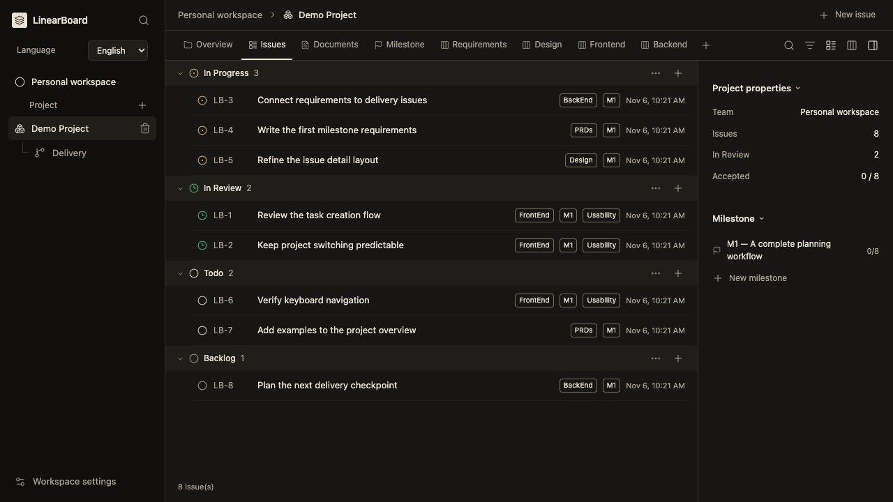
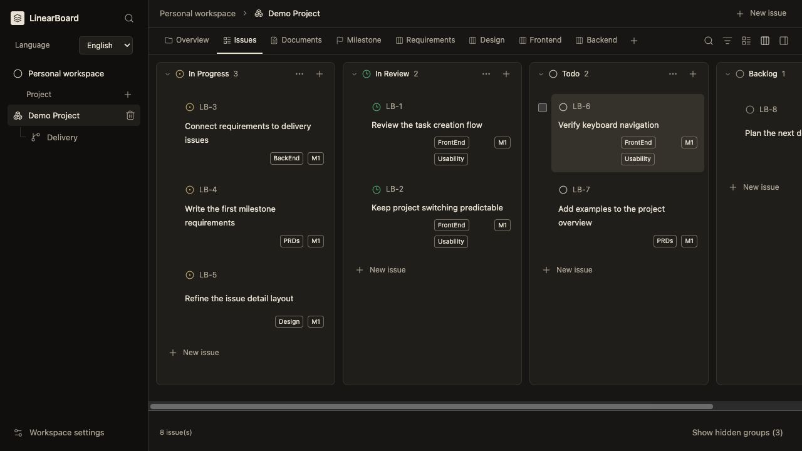
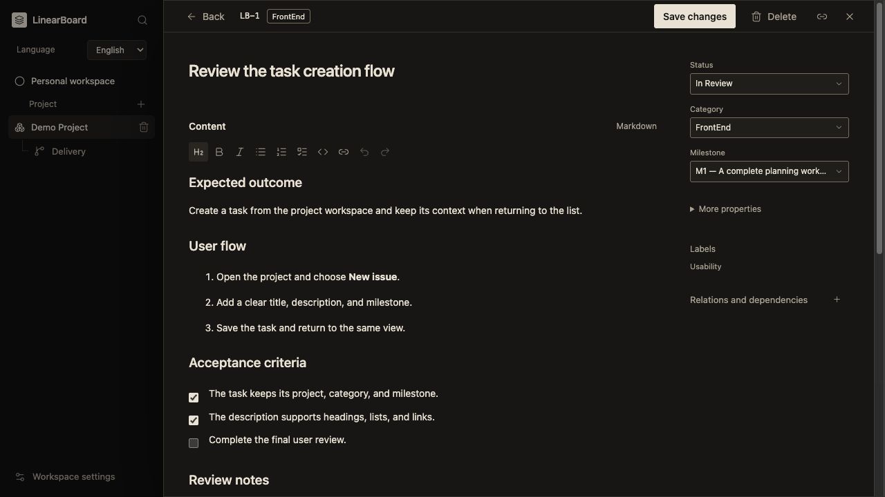

# LinearBoard

[English](README.md) · [繁體中文](README.zh-TW.md)

A local workspace for projects, tasks, documents, and delivery reviews. It works without a Linear account or an AI API key. To run the workflow in Codex, use the included LinearBoard skill.

[Quick start](#quick-start) · [My workflow](#my-workflow) · [Command execution](#how-a-command-runs) · [Articles](#articles) · [Interface tour](#interface-tour) · [Codex integration](#mcp-integration)



*Current English interface with fictional demo data. Your workspace starts without prefilled project tasks.*

## Why I built LinearBoard

I took inspiration from [Linear](https://linear.app) and the way it lets me move from a project overview to a milestone or an individual issue. I wanted a local workspace where I could follow that same path through AI-assisted development, even when the planning, implementation, and review happen in separate chats. I built most of LinearBoard with [OpenAI Codex](https://developers.openai.com/learn/codex).

## My workflow

In PocketMap, “save a place” became a set of decisions I could test. How do I recognize a duplicate? What happens if the save fails? Can I find the place after reopening the app? I start with the user story, record those decisions in a product requirements document (PRD), and link the design and implementation tickets back to it. When I review the result, I can trace a failed check to the rule that explains what should happen.

Here's the sequence I use for a milestone with screens. Each command runs when I ask for it. I can resume from records I've already confirmed and skip design steps when the work has no visual requirements.

```text
planning -> create-vision-document
    |
    +-- create-technical-baseline (if needed)
    |
    v
create-milestones -> milestones + grouped stories
    |
    v
create-PRDs -> clarify open product decisions
    |
    v
create-designs -> choose a direction
    |
    v
create-visuals -> approve the full set -> Design tickets + Approved JPGs
    |
    v
create-issues-FE / create-issues-BE -> organize-task-batch (if needed)
    |
    v
dispatch -> implementer reports -> independent reviewer checks the target
    |
    +-- all required checks and acceptance gates met -> Done (in the app)
    +-- required test unavailable -> Todo + what to verify next
    +-- product failure or unfinished work -> remediation
    `-- review underway or explicit acceptance pending -> In Review

Confirmed change across records -> sync preview -> I approve -> update
```

I use `debug` to turn review feedback into a linked bug ticket. When an agreed change affects several records, I use `sync` to preview the proposed edits and approve what should be updated.

## How a command runs

Follow [Quick start](#quick-start) and [load the skill](#included-management-skill), then send `$linearboard help` in Codex chat. Use `planning` for a new idea, or name an existing project and milestone to continue from its saved records. These are chat prompts.

```text
Command in Codex chat -> LinearBoard skill chooses the workflow
    |
    +-- help -> show the command guide offline
    +-- init -> prepare the product repository for Codex
    +-- planning -> clarify the idea in chat
    |
    `-- command that uses the board
        -> connect through MCP or the local HTTP helper
        -> resolve the requested team, project, and milestone as needed
        -> check existing records and required decisions
        -> pause for missing input or approval when needed
        -> carry out the requested work and save authorized changes
        -> read back the result and report what was verified
```

LinearBoard stores decisions, tickets, and evidence. Codex runs the requested workflow. During delivery, a reviewer other than the implementer checks the target, records the evidence, and applies the status. Required user decisions, such as approving a design or accepting a ticket that explicitly asks for sign-off, stay with you.

Codex ends with **Recommended next step**. It tells you how to resume a pending decision or gives the next command and why it helps. When the same command can cover a focused milestone or a wider set of ready milestones, it shows both options. You choose what to run.

### Example: Pick up an existing milestone

Suppose PocketMap already has a milestone called **M1 — Save a place** with a grouped user story. Send:

```text
$linearboard create-PRDs "PocketMap" "M1 — Save a place"
Use the existing save-place story. Ask me about the first unresolved rule
that affects what the user can do or how we'll test it.
```

Check that the saved requirements link back to the story and that your answer appears in the owning PRD. Once the related delivery tickets are ready and labeled **Batch 1**, `$linearboard dispatch "PocketMap" "M1 — Save a place" Batch 1` asks Codex to implement that batch. For example, if saving works but a required device check cannot run, the reviewer records the missing check and moves the ticket to `Todo`.

The [hands-on guide](docs/linearboard-guides/hands-on.en.html#examples) walks through command selection, scope choices, and the delivery checks with copyable prompts. Open the HTML file locally for the interactive guide.

## Articles

I wrote this series while building PocketMap with Linear and the `linear-tpm` skill. It shows where the workflow came from. Use the command flow above for the current local LinearBoard skill.

1. [AI-Assisted Product Building](https://medium.com/@bchuan110/ai-assisted-product-building-d6572d3edead) — from the product idea to milestones and user stories.
2. [Continued: AI-Assisted Product Building — Documentations](https://medium.com/@bchuan110/continued-ai-assisted-product-building-documentations-85bcc10daedf) — how the save-place story became requirements, designs, and frontend and backend tickets.
3. [Continued: AI-Assisted Product Building — Review Results](https://medium.com/@bchuan110/continued-ai-assisted-product-building-review-results-e2119098a793) — how I reviewed the implementation and recorded feedback.

## Quick start

Requires Docker with Compose. The image build installs its Node and Python dependencies.

```sh
git clone https://github.com/CJsGit-tech/LinearBoard.git
cd LinearBoard
python3 scripts/setup_compose.py
docker compose up -d --build
```

Open [http://127.0.0.1:8765](http://127.0.0.1:8765). The initial workspace contains a Personal team; create your first project in the app. No production tasks are prefilled.

```sh
docker compose ps
docker compose logs --tail 100 app
docker compose stop
docker compose start
```

The app is published only on the host's loopback address. PostgreSQL has no published host port. The generated password is mounted from `data/docker/database-password` as a Compose secret; setup preserves an existing password. Keep that file private and out of version control.

`docker compose down` retains the database volume. **Do not use `docker compose down -v` to stop the app:** it removes the database volume.

## Create your first project

1. Open the app and choose **Create project** beside **Project** in the sidebar.
2. Add a milestone, then choose **New issue**. Set its category, status, and milestone.
3. Open the issue to write a description or acceptance checklist. Choose **Save changes** in the top toolbar.
4. Switch to **Board view**, or create a saved View for the category you use most.

For guided product planning, start with the [English hands-on guide](docs/linearboard-guides/hands-on.en.html) or [繁體中文操作指南](docs/linearboard-guides/hands-on.zh-Hant.html). Both include copyable prompts, expected outputs, and checks to perform afterward. Replace `<Project>` and other placeholders before sending a prompt to Codex. Download or open the HTML files locally to use the interactive guides; a repository file viewer shows their source.

## Interface tour

### See work by status

Choose **List view** to scan tasks, or **Board view** to see work in columns and drag tasks between states. The board scrolls horizontally, and you can hide unused columns from their group menus. To update several tasks, select them using the left edge of each row, or choose **Select all in group**, then use **Actions**.



*The board shows which tasks are in progress and which are waiting for review.*

### Edit the task where you read it

Write headings, lists, links, and acceptance checklists in the rich-text editor, or switch to Markdown. Status, category, and milestone stay alongside the description. Use the top toolbar to save, go back, or delete; comments, attachments, evidence, and revision history continue below the editor.



*The issue keeps the acceptance checklist beside its status and milestone so I can review the expected behavior in context.*

### Know where things live

| Area | What you do there |
| --- | --- |
| Project list in the sidebar | Click a project to switch its workspace. |
| Overview and Milestone | Read the project context and milestone outcomes. |
| Issues and saved Views | Work with tasks and reusable category/filter combinations. |
| Documents | Keep the vision, grouped stories, PRD-related notes, and design specifications. |
| Delivery beneath the selected project | Inspect saved batches, dispatch plans, and reports. |
| Workspace settings | Manage teams, labels, trash, and database backups. |

The interface uses a dark, warm-neutral palette, compact task rows, and consistent menus. The sidebar selects the project; top tabs organize its content; the optional right panel shows project details. This keeps navigation and task editing in the same workspace.

## Language

The interface supports **English** and **Traditional Chinese**. On first use, Chinese browser locales select Traditional Chinese; other browser locales select English. Use **Language** in the sidebar to switch at any time. The choice is saved in that browser, and changing it preserves the current screen and unsaved form contents.

Navigation, forms, editor controls, accessibility labels, notifications, dates, and API validation messages follow the selected language. Project names, issue titles, documents, comments, labels, custom workflow states, and other user-authored content are preserved as entered. The skill is written in English. The app links English users to an English user guide.

## Optional SQLite development mode

Requires Python 3.12+ and Node.js 20+.

```sh
npm ci
npm run build
python3 server.py
```

Build the frontend after cloning or changing UI source; `web/dist/` is generated and is not committed. There is no separate frontend dev server. You can select a disposable database and alternate port:

```sh
python3 server.py --port 9000 --db /absolute/path/to/development.sqlite3
```

Without `DATABASE_URL`, the server uses SQLite (by default `data/linearboard.sqlite3`). Compose configures PostgreSQL using `DATABASE_URL` and `DATABASE_PASSWORD_FILE`.

## Features and shortcuts

- **Projects and milestones:** describe outcomes and group work under native milestones.
- **Issues:** use list or board layouts, filters, search, categories, priorities, assignees, parent issues, and relations. Drag issues between status columns or edit their status in the form.
- **Documents:** edit rich text or Markdown, attach documents to projects and milestones, and retain comments and revision history. Content containing HTML stays in source editing mode to preserve it.
- **Views:** save project-scoped filters with category, labels, states, milestone, grouping, and tab or shared-sidebar placement.
- **Attachments:** upload files or external links with screen/version metadata and review labels. Uploads are limited to 15 MB. Only recognized PNG/JPEG bytes render inline; other files download.
- **Delivery:** record FE/BE batches, dispatch plans and reports, and independent verification evidence. A dispatch record does not execute an agent.
- **Settings:** manage teams and workflow states, label groups, recoverable trash, database backups, and integration help.

Press **C** to create an issue and **/** to search outside editable controls. Forms use explicit Save buttons. Record details provide Back navigation and **Alt+←**. Updates from external tools appear on explicit navigation or reopening a record; an open editor is not overwritten by background writes.

Default workflow states: Backlog, Todo, In Progress, In Review, Done, Canceled, and Duplicate. Teams can define custom states. A referenced state cannot be removed. An authorized reviewer uses the native UI for **Done** after meeting the required checks and any explicit acceptance gate. Other than Design JPGs that inherit a recorded set approval, native attachment approval stays with the user.

## Data, backups, and trash

Compose stores canonical records, attachment bytes, history, retry keys, and trash in the named PostgreSQL volume `linearboard_postgres_data`. Browser local storage holds presentation preferences, the selected project, and language.

**Workspace settings → Download database backup** returns a PostgreSQL custom-format `linearboard.pgdump` in Compose mode, or a SQLite backup in SQLite mode. Restore PostgreSQL backups with `pg_restore` into a new empty database, verify the restored contents, then switch connections. Do not overwrite a running database or copy only a live SQLite main file while ignoring its WAL.

Trash retains IDs and history until the user permanently deletes records. Deleting an issue includes its descendants; deleting a project includes its owned records. The app previews the impact and restores without overwriting later changes. Restore required parent records first. Permanent deletion cannot be undone; older backups may still contain the deleted data.

The app is designed for its owner on the same machine. `X-LinearBoard-Actor: user` marks local manual actions; it is not network authentication. Do not expose this service to an untrusted network.

### Migrate an existing SQLite workspace

Retain a consistent SQLite backup as your migration source. Stop writes during migration and do not run the app against the destination until verification completes.

```sh
python3 scripts/setup_compose.py
docker compose up -d db
docker compose run --rm migrate /source/your-backup.sqlite3
docker compose up -d app
```

The migration service mounts local `data/` read only at `/source`. Migration verifies row counts and SHA-256 across records, history, requests, blobs, counters, and trash batches in one transaction. It preserves identities and rejects a different, nonempty destination. An identical rerun makes no changes. The old SQLite file is a historical backup, not a synchronized replica.

## MCP integration

Start the HTTP app first, then configure a stdio server in your MCP client:

```json
{
  "mcpServers": {
    "linearboard": {
      "command": "python3",
      "args": [
        "/absolute/path/to/LinearBoard/mcp_server.py",
        "--url", "http://127.0.0.1:8765"
      ]
    }
  }
}
```

Available tools include `linearboard_capabilities`, `linearboard_list`, `linearboard_get`, `linearboard_create`, `linearboard_update`, `linearboard_update_issue_statuses`, and the `linearboard_trash_*` operations. Inspect `/api/capabilities` for exact fields and contracts. List calls are paginated; follow every `next_cursor`. The supplied `linearboard.client.Client` supports MCP connections, readback, reuse, and exact retries.

LinearBoard persists records and exposes the 15 canonical commands and their aliases in the capability catalog. Codex and external tools interpret the skill, build and review local HTML prototypes, run agents, and inspect the actual target product. Share runnable prototype links in chat and link the owning Design tickets or their native Approved JPGs from LinearBoard records.

### Included management skill

The complete bundle is in [`skills/linearboard/`](skills/linearboard/): `SKILL.md`, references, reusable authoring templates, agent metadata, and Python tools. These are workflow instructions, not a copy of a project's requirements or delivery records.

Point Codex at the repository's LinearBoard `SKILL.md`, or install both [`skills/linearboard/`](skills/linearboard/) and [`skills/design-pro/`](skills/design-pro/) as sibling folders under `~/.codex/skills/`. Preserve any existing installations first. Both design commands use the bundled sibling `design-pro`. The sync workflow references the separately installed `file-change-summary` skill. For a checkout at a different path, set:

```sh
export LINEARBOARD_PROJECT_DIR="/absolute/path/to/LinearBoard"
```

Perform the initial Compose setup yourself using the steps above. The skill's preflight reuses or starts an existing deployment; it does not initialize volumes, migrate data, or rotate passwords. Image-generation commands also require the host's `imagegen` skill and tools, which are not bundled here.

For a product repository already configured with this skill, run `$linearboard init <Project> [repository path]` again to refresh the managed instructions and reviewer role. Start a fresh Codex chat in that repository to load the refreshed configuration.

The bundle is a publication snapshot. Changes to a personal skill installation do not automatically update this repository. Product requirements, planning decisions, task states, approvals, and delivery evidence belong in the LinearBoard application rather than a parallel repository backlog.

## REST API

| Operation | Endpoint |
| --- | --- |
| Capabilities | `GET /api/capabilities` |
| Paginated list | `GET /api/{kind}?filters={URL-encoded JSON}&cursor=0&limit=100` |
| Get one record | `GET /api/{kind}/{id}` |
| Create | `POST /api/{kind}` |
| Update | `PATCH /api/{kind}/{id}` |
| History | `GET /api/history/{id}` |
| Actual View membership | `GET /api/views/{id}/members` |
| Attachment bytes | `GET /api/files/{id}` |
| Consistent backup | `GET /api/backup` |

Kinds include teams, projects, milestones, labels, issues, documents, views, comments, relations, attachments, batches, dispatches, and evidence. Stable record `url` fields are relative UI deep links.

Send JSON writes with `Content-Type: application/json`. PATCH requires the current `expected_version`; a stale version returns 409. Use one `Idempotency-Key` per logical write and reuse the same key and exact payload when retrying. Reusing a key with different content returns 409. A repeated title alone does not deduplicate a create operation.

Send `Accept-Language: en` for English API errors or `zh-TW` for Traditional Chinese. When omitted, API errors retain the Chinese default for existing clients. Localized errors return `Content-Language` and `Vary: Accept-Language`. Record data and identifiers are not translated.

## Development and checks

```sh
npm run build
npm test
npm run test:i18n
npm run test:guide
npm run test:ui
npm run test:selects
```

Browser tests use installed Google Chrome and disposable SQLite databases, not the canonical workspace. The localization suite checks English and Chinese navigation, editing, persistence, language switching, errors, and content preservation. The guide suite checks the current skill command directory, prompt composer, search, reading progress, mobile navigation, strict Content Security Policy, and working browser/server offline exports.

Main source areas: `web/` (React UI and message catalog), `linearboard/store.py` (validation and persistence), `linearboard/postgres.py` (PostgreSQL backend), `server.py` (HTTP routes), `mcp_server.py` (MCP bridge), and `tests/`. English API errors are in `linearboard/locales/en.json`.

The app uses React, Radix Primitives, Tiptap, Lucide, Marked, DOMPurify, esbuild, and Playwright. Exact dependency versions are locked in `package-lock.json`. The built app has no CDN, remote font, or image dependency. The optional local `/visuals/` review gallery is not included in Git or the Docker image.

Workspace databases, credentials, backups, generated review assets, dependencies, and build output are excluded by `.gitignore`.
